<!--
  Profil-README · Marlon Betin (CodeByMarlon) · Versionen: README.md (pt), README.en.md, README.de.md
-->

  

<a href="https://codebymarlon.vercel.app/" title="Mein Portfolio öffnen">
  <picture>
    <source media="(prefers-color-scheme: dark)" srcset="https://readme-typing-svg.demolab.com?font=JetBrains+Mono&weight=600&size=21&duration=3000&pause=1000&color=22D3EE&center=true&vCenter=true&width=780&height=46&lines=Software+Engineer+%C2%B7+Python+%26+Django;Echtzeitsysteme+f%C3%BCr+den+Nahverkehr;DevOps%2C+CI%2FCD+und+agile+Methoden;Angewandte+KI%3A+Claude+Code%2C+MCPs+und+Agenten" />
    
  </picture>
</a>

  
  
  
  

<a href="#ueber-mich"><b>Über mich</b></a> &nbsp;•&nbsp;
<a href="#kompetenzen"><b>Kompetenzen</b></a> &nbsp;•&nbsp;
<a href="#erfahrung"><b>Erfahrung</b></a> &nbsp;•&nbsp;
<a href="#devops"><b>DevOps &amp; Agil</b></a> &nbsp;•&nbsp;
<a href="#stack"><b>Stack</b></a> &nbsp;•&nbsp;
<a href="#ki"><b>KI &amp; MCPs</b></a> &nbsp;•&nbsp;
<a href="#aktivitaet"><b>Aktivität</b></a> &nbsp;•&nbsp;
<a href="#kontakt"><b>Kontakt</b></a>

##  Über mich

Ich bin **Software Engineer bei der [AMEP](https://www.amep.pr.gov.br/)** (Agência de Assuntos Metropolitanos do Paraná, die Behörde für Metropolangelegenheiten des brasilianischen Bundesstaates Paraná) in der Verkehrsdirektion (DTIM). Ich entwickle Systeme von der Anforderung bis zum Betrieb, die die Verwaltung, Kontrolle und **Echtzeit**-Überwachung des öffentlichen Nahverkehrs in der Metropolregion Curitiba unterstützen.

Ich bin über das **Gesundheitswesen** zur IT gekommen. Als Pflegekraft (Técnico de Enfermagem) habe ich in kritischen Versorgungsbereichen gearbeitet. Dort habe ich gelernt, unter Druck Entscheidungen zu treffen, Protokolle genau einzuhalten und kein Detail zu übersehen. Diese Sorgfalt bringe ich heute in Systeme ein, die nicht ausfallen dürfen.

- **End-to-End:** Datenmodellierung, APIs, Integrationen, Frontend, CI/CD und Betrieb in Produktion
- **Echtzeit und Geodaten:** Flottentelemetrie, Live-Karten, Routing und Dashboards für Leitstellen
- **DevOps und Agilität:** CI/CD-Pipelines sowie XP- und Scrum-Praktiken, gemeinsam mit dem Team eingeführt
- **KI mit Methode:** Claude Code orchestriert Subagenten und MCP-Server, dazu TRAE und Antigravity, stets abgesichert durch Tests und Reviews
- **Studium:** Software Engineering an der UNICURITIBA (laufend)
- **Ich suche:** Positionen in Software Engineering, Backend/Plattform und Full Stack

##  Kompetenzen

##  Berufserfahrung

### Software Engineer · AMEP, Verkehrsdirektion (DTIM)

**Nov. 2025 – heute** · Curitiba, Brasilien · Öffentlicher Sektor · Urbane Mobilität

Ich entwickle die Webplattform der Direktion weiter, die Verwaltung, Kontrolle und Überwachung des Nahverkehrs in der Metropolregion unterstützt. Dabei arbeite ich im gesamten Zyklus mit: Anforderungsaufnahme mit den Fachbereichen, Architektur, Entwicklung, Tests, Deployment und Betrieb in Produktion, mit Python, Django, PostgreSQL, Celery und WebSocket.

> [!NOTE]
> Es handelt sich um interne Systeme der Behörde, daher sind Code und Daten nicht öffentlich. Hier beschreibe ich nur die eingesetzten Kompetenzen.

<table>
<tr>
<td width="50%" valign="top">

####  Echtzeit-Überwachung
Flottentelemetrie mit Live-Karten, Ankunftsprognosen je Haltestelle und Erkennung von Geschwindigkeitsüberschreitungen, dazu ein Videowall-Dashboard für die Betriebsleitstelle mit barrierefreien Alarmen.

`Django` `Leaflet` `JavaScript` `Redis` `Celery`

</td>
<td width="50%" valign="top">

####  Reiseplanung
Eigene Routing-Engine mit Umstiegen zwischen Linien, echten Fußwegen aus OpenStreetMap, Tarifen und Live-Ankunftszeiten der Busse, validiert gegen Google Maps.

`Routing-Algorithmen` `OpenStreetMap` `OSRM`

</td>
</tr>
<tr>
<td width="50%" valign="top">

####  Datenintegration
Externe APIs und Feeds zu Mobilität, Wetter und Karten, ETL-Prozesse mit Testlauf und Rollback, mehrstufiges Caching und überwachte geplante Jobs.

`ETL` `pandas` `Polars` `Celery Beat`

</td>
<td width="50%" valign="top">

####  Flottenmanagement und -prüfung
Fahrzeugkontrollen vor Ort über mobile Formulare, Verfolgung der Nutzungsdauer der Flotte und Prüfung der Fahrleistung mit GPS-Validierung, inklusive Excel- und PDF-Berichten.

`PostgreSQL` `Webhooks` `openpyxl` `ReportLab`

</td>
</tr>
<tr>
<td width="50%" valign="top">

####  KI-Datenassistent
Fragen in natürlicher Sprache, sicher beantwortet: Die KI erzeugt einen strukturierten Intent, der schreibgeschützt und mit Audit-Trail ausgeführt wird.

`LLMs` `Hugging Face` `Gemini` `LGPD`

</td>
<td width="50%" valign="top">

####  Sicherheit und Datenschutz
Rollenbasierte Zugriffskontrolle, Zwei-Faktor-Authentifizierung, Verschlüsselung personenbezogener Daten, Content Security Policy und Audit-Trails.

`RBAC` `2FA` `Verschlüsselung` `LGPD`

</td>
</tr>
</table>

##  DevOps, CI/CD und agile Methoden

Seit meinem Einstieg bei der AMEP im November 2025 hatte ich die Gelegenheit, erstmals in der Behörde Praktiken aus dem DevOps-Engineering und der agilen Softwareentwicklung vorzuschlagen und einzuführen. Das war echte Teamarbeit, mit Unterstützung der Leitung und Schritt für Schritt an die Realität des öffentlichen Sektors angepasst, mit einem einfachen Ziel: sicherer, hochwertiger und planbarer zu liefern.

- **CI/CD-Pipeline:** Jede Änderung durchläuft einen Pull Request mit Code-Review sowie automatisierte Tests mit Abhängigkeitsaudit und Migrationsprüfung, wird im Staging abgenommen und gelangt erst dann per automatisiertem Deployment in Produktion.
- **Einheitliche Umgebungen:** Entwicklung, Staging und Produktion in als Code definierten Containern, mit Health-Checks, zugänglichen Logs und Backup-Routine.
- **XP im Alltag:** Continuous Integration, automatisierte Tests, ständiges Refactoring, kleine und häufige Releases sowie Standards für Code und Commits.
- **Scrum:** Arbeit in kurzen Zyklen, mit einem gemeinsam mit den Fachbereichen priorisierten Backlog, Reviews der Ergebnisse und Retrospektiven zur kontinuierlichen Verbesserung.
- **Geteiltes Wissen:** dokumentierte Architekturentscheidungen, Handbücher und eine lebende Wissensbasis, damit das Wissen im Team bleibt.

##  Tech-Stack

  

| Bereich | Technologien |
|---|---|
| **Backend** |        |
| **Frontend** |       |
| **Daten** |       |
| **Geo & Echtzeit** |     |
| **DevOps & CI/CD** |          |
| **Agile Methoden** |      |
| **Qualität & Sicherheit** |        |
| **KI & Agenten** |       |
| **Reverse Engineering** |        |
| **Werkzeuge** |       |
| **Studium** |    |

##  Angewandte KI, MCPs und Orchestrierung

Ich setze KI als **Teil des Engineering-Prozesses** ein, nicht als Abkürzung: Spezifikation, Plan, Umsetzung mit Subagenten, zweistufiges Review, Tests und Pull Request. Alles, was die KI erzeugt, durchläuft CI, Tests und Review, bevor es in Produktion geht.

| Werkzeug | Wie ich es im Alltag nutze |
|---|---|
| **Claude Code** | Zentraler Orchestrator: parallele Subagenten, Skills, Hooks, Projektregeln (`CLAUDE.md`) und sitzungsübergreifendes Gedächtnis |
| **MCP · GitHub** | Repositories, Issues, Pull Requests und Code-Reviews direkt aus dem Terminal |
| **MCP · Chrome DevTools** | Netzwerk und Konsole debuggen, Performance messen und Oberflächen in mehreren Auflösungen prüfen |
| **MCP · Obsidian** | Lebende Dokumentation: Architektur, Entscheidungen und Verlauf, bei jeder Lieferung aktualisiert |
| **MCP · Graphify** | Code-Graph, um die Auswirkungen einer Änderung vorab zu bewerten |
| **MCP · Figma und Linear** | Vom Design zum Code und Aufgabenmanagement |
| **MCP · REA** | Reverse Engineering und Dekompilierung: native Binärdateien, Android-Apps und JavaScript-/WebAssembly-Bundles |
| **TRAE IDE (SOLO)** und **Google Antigravity** | IDEs mit Agenten zum Prototyping und zum Parallelisieren von Aufgaben |

**Orchestrierung von Systemen.** Neben den Agenten orchestriere ich Dienste in Produktion: Container mit Docker Compose, Queues und geplante Jobs mit Celery, Datenerfassung in Echtzeit, ETL-Prozesse mit Testlauf und Rollback sowie automatisierte Deployments.

**Reverse Engineering und Dekompilierung.** Ich analysiere Binärdateien, Android-Apps und JavaScript-/WebAssembly-Bundles mit KI-Agenten (REA MCP) und untersuche Netzwerkverkehr, um Integrationen zu verstehen, stets ethisch und nur im Rahmen autorisierter Zugriffe.

##  GitHub-Aktivität

  

  <picture>
    <source media="(prefers-color-scheme: dark)" srcset="https://raw.githubusercontent.com/CodeByMarlon/CodeByMarlon/output/cobrinha-escura.svg" />
    
  </picture>

##  Lassen Sie uns sprechen

Ich bin **offen für neue Positionen** in Software Engineering, Backend/Plattform und Full Stack. Wenn Sie jemanden suchen, der Systeme mit Tests, Sicherheit und Dokumentation in Produktion bringt, gern im Team arbeitet und KI methodisch einsetzt, freue ich mich auf Ihre Nachricht.

  
  
  

