<!--
  Profile README · Marlon Betin (CodeByMarlon) · versions: README.md (pt), README.en.md, README.de.md
-->

  

<a href="https://codebymarlon.vercel.app/" title="Open my portfolio">
  <picture>
    <source media="(prefers-color-scheme: dark)" srcset="https://readme-typing-svg.demolab.com?font=JetBrains+Mono&weight=600&size=21&duration=3000&pause=1000&color=22D3EE&center=true&vCenter=true&width=780&height=46&lines=Software+Engineer+%C2%B7+Python+%26+Django;Real-time+public+transit+systems;DevOps%2C+CI%2FCD+and+agile+methods;Applied+AI%3A+Claude+Code%2C+MCPs+and+agents" />
    
  </picture>
</a>

  
  
  
  

<a href="#about"><b>About</b></a> &nbsp;•&nbsp;
<a href="#expertise"><b>Expertise</b></a> &nbsp;•&nbsp;
<a href="#experience"><b>Experience</b></a> &nbsp;•&nbsp;
<a href="#devops"><b>DevOps &amp; Agile</b></a> &nbsp;•&nbsp;
<a href="#stack"><b>Stack</b></a> &nbsp;•&nbsp;
<a href="#ai"><b>AI &amp; MCPs</b></a> &nbsp;•&nbsp;
<a href="#activity"><b>Activity</b></a> &nbsp;•&nbsp;
<a href="#contact"><b>Contact</b></a>

##  About me

I'm a **Software Engineer at [AMEP](https://www.amep.pr.gov.br/)** (Paraná Metropolitan Affairs Agency, Brazil), in the Transportation Directorate (DTIM). I build, end to end, the systems that support the management, inspection and **real-time** monitoring of public transit across the Curitiba metropolitan region.

I came to technology from **healthcare**. As a nursing technician, I worked in critical-care settings, where I learned to make decisions under pressure, follow protocols to the letter and never let a detail slip. Today I bring the same care to systems that cannot go down.

- **End to end:** data modeling, APIs, integrations, front end, CI/CD and production operations
- **Real time and geodata:** fleet telemetry, live maps, routing and operations-center dashboards
- **DevOps and agility:** CI/CD pipelines and XP and Scrum practices, introduced together with the team
- **AI with method:** Claude Code orchestrating subagents and MCP servers, plus TRAE and Antigravity, always backed by tests and review
- **Education:** Software Engineering degree at UNICURITIBA (in progress)
- **Looking for:** Software Engineering, Back-end/Platform and Full Stack roles

##  Expertise

##  Experience

### Software Engineer · AMEP, Transportation Directorate (DTIM)

**Nov 2025 – present** · Curitiba, Brazil · Public sector · Urban mobility

I develop and evolve the directorate's web platform, which supports the management, inspection and monitoring of metropolitan public transit. I work across the whole cycle: gathering requirements with business users, architecture, development, testing, deployment and production operations, using Python, Django, PostgreSQL, Celery and WebSocket.

> [!NOTE]
> These are internal systems of the institution, so the code and data are not public. Here I describe only the skills involved.

<table>
<tr>
<td width="50%" valign="top">

####  Real-time monitoring
Fleet telemetry with live maps, stop-by-stop arrival predictions and speeding detection, plus a videowall dashboard for the operations control center with accessible alerts.

`Django` `Leaflet` `JavaScript` `Redis` `Celery`

</td>
<td width="50%" valign="top">

####  Trip planning
In-house routing engine with transfers between lines, real walking routes from OpenStreetMap, fares and live bus arrival times, validated against Google Maps.

`Routing algorithms` `OpenStreetMap` `OSRM`

</td>
</tr>
<tr>
<td width="50%" valign="top">

####  Data integration
External mobility, weather and map APIs and feeds, ETL jobs with dry runs and rollback, layered caching and monitored scheduled tasks.

`ETL` `pandas` `Polars` `Celery Beat`

</td>
<td width="50%" valign="top">

####  Fleet management and auditing
Field inspections integrated with mobile forms, fleet lifecycle tracking and mileage auditing with GPS validation, with Excel and PDF reports.

`PostgreSQL` `Webhooks` `openpyxl` `ReportLab`

</td>
</tr>
<tr>
<td width="50%" valign="top">

####  AI data assistant
Natural-language questions answered safely: the AI produces a structured intent that runs in read-only mode with an audit trail.

`LLMs` `Hugging Face` `Gemini` `LGPD`

</td>
<td width="50%" valign="top">

####  Security and privacy
Role-based access control, two-factor authentication, encryption of personal data, a content security policy and audit trails.

`RBAC` `2FA` `Encryption` `LGPD`

</td>
</tr>
</table>

##  DevOps, CI/CD and agile methods

Since joining AMEP in November 2025, I have had the opportunity to propose and introduce, for the first time at the institution, DevOps engineering and agile development practices. It has been a joint effort with the team, with support from management, adapted step by step to the realities of the public sector, with one simple goal: delivering with more safety, quality and predictability.

- **CI/CD pipeline:** every change goes through a pull request and code review, runs automated tests with dependency audits and migration checks, is validated in staging and only then reaches production through an automated deploy.
- **Standardized environments:** development, staging and production in containers defined as code, with service health checks, accessible logs and a backup routine.
- **XP day to day:** continuous integration, automated tests, constant refactoring, small and frequent releases, and code and commit standards.
- **Scrum:** work organized in short cycles, with a backlog prioritized together with business users, reviews of each delivery and retrospectives for continuous improvement.
- **Shared knowledge:** recorded architecture decisions, manuals and a living knowledge base, so that knowledge stays with the team.

##  Tech stack

  

| Area | Technologies |
|---|---|
| **Back end** |        |
| **Front end** |       |
| **Data** |       |
| **Geo & real time** |     |
| **DevOps & CI/CD** |          |
| **Agile methods** |      |
| **Quality & security** |        |
| **AI & agents** |       |
| **Reverse engineering** |        |
| **Tools** |       |
| **Academic background** |    |

##  Applied AI, MCPs and orchestration

I use AI as **part of the engineering process**, not as a shortcut: specification, plan, execution with subagents, two-stage review, tests and pull request. Everything the AI produces goes through CI, tests and review before it reaches production.

| Tool | How I use it day to day |
|---|---|
| **Claude Code** | Main orchestrator: parallel subagents, skills, hooks, project rules (`CLAUDE.md`) and memory across sessions |
| **MCP · GitHub** | Repositories, issues, pull requests and code review without leaving the terminal |
| **MCP · Chrome DevTools** | Debugging network and console, measuring performance and checking screens at multiple resolutions |
| **MCP · Obsidian** | Living documentation: architecture, decisions and history updated with every delivery |
| **MCP · Graphify** | Code graph to measure the impact of a change before making it |
| **MCP · Figma and Linear** | From design to code, and task management |
| **MCP · REA** | Reverse engineering and decompilation: native binaries, Android apps and JavaScript/WebAssembly bundles |
| **TRAE IDE (SOLO)** and **Google Antigravity** | Agentic IDEs for prototyping and parallelizing tasks |

**Systems orchestration.** Beyond agents, I orchestrate services in production: containers with Docker Compose, queues and scheduled jobs with Celery, real-time data collection, ETL jobs with dry runs and rollback, and automated deploys.

**Reverse engineering and decompilation.** I analyze binaries, Android apps and JavaScript/WebAssembly bundles with AI agents (REA MCP) and inspect network traffic to understand integrations, always ethically and within authorized access.

##  GitHub activity

  

  <picture>
    <source media="(prefers-color-scheme: dark)" srcset="https://raw.githubusercontent.com/CodeByMarlon/CodeByMarlon/output/cobrinha-escura.svg" />
    
  </picture>

##  Let's talk

I'm **open to opportunities** in Software Engineering, Back-end/Platform and Full Stack. If you're looking for someone who takes systems to production with tests, security and documentation, enjoys working as part of a team and uses AI with method, let's talk.

  
  
  

