<!--
  README do perfil · Marlon Betin (CodeByMarlon)
  Visuais próprios em ./assets (SVG animados, leves e sem serviço externo).
  assets/contribuicoes.svg é refeito todo dia por .github/workflows/contribuicoes.yml.
-->

<a href="https://codebymarlon.vercel.app/" title="Abrir meu portfólio">
  <picture>
    <source media="(prefers-color-scheme: dark)" srcset="https://readme-typing-svg.demolab.com?font=JetBrains+Mono&weight=600&size=21&duration=3000&pause=1000&color=22D3EE&center=true&vCenter=true&width=780&height=46&lines=Engenheiro+de+Software+%C2%B7+Python+%26+Django;Sistemas+de+transporte+em+tempo+real;DevOps%2C+CI%2FCD+e+m%C3%A9todos+%C3%A1geis;IA+aplicada%3A+Claude+Code%2C+MCPs+e+agentes" />
    
  </picture>
</a>

  
  
  
  

<a href="#sobre"><b>Sobre</b></a> &nbsp;•&nbsp;
<a href="#competencias"><b>Competências</b></a> &nbsp;•&nbsp;
<a href="#experiencia"><b>Experiência</b></a> &nbsp;•&nbsp;
<a href="#devops"><b>DevOps &amp; Ágil</b></a> &nbsp;•&nbsp;
<a href="#stack"><b>Stack</b></a> &nbsp;•&nbsp;
<a href="#ia"><b>IA &amp; MCPs</b></a> &nbsp;•&nbsp;
<a href="#atividade"><b>Atividade</b></a> &nbsp;•&nbsp;
<a href="#contato"><b>Contato</b></a>

## 👨‍💻 Sobre mim

Sou **Engenheiro de Software na [AMEP](https://www.amep.pr.gov.br/)** (Agência de Assuntos Metropolitanos do Paraná), na Diretoria de Transporte (DTIM). Desenvolvo, de ponta a ponta, sistemas que apoiam a gestão, a fiscalização e o monitoramento **em tempo real** do transporte público da Região Metropolitana de Curitiba.

Cheguei à tecnologia vindo da **saúde**. Como técnico de enfermagem, trabalhei em ambientes críticos, onde aprendi a decidir sob pressão, seguir protocolos à risca e não deixar nenhum detalhe passar. Hoje levo esse cuidado para sistemas que não podem parar.

- 🏗️ **Ponta a ponta:** modelagem de dados, APIs, integrações, front-end, CI/CD e operação em produção
- 🛰️ **Tempo real e geodados:** telemetria de frota, mapas ao vivo, roteamento e painéis de controle operacional
- 🔁 **DevOps e agilidade:** pipelines de CI/CD e práticas de XP e Scrum, implantadas junto com a equipe
- 🤖 **IA com método:** Claude Code orquestrando subagentes e servidores MCP, TRAE e Antigravity, sempre com testes e revisão
- 🎓 **Formação:** Engenharia de Software na UNICURITIBA (em andamento)
- 🎯 **Procuro:** oportunidades em Engenharia de Software, Back-end/Plataforma e Full Stack

<b>🌎 English summary</b>

 

**Software Engineer** at AMEP (Paraná Metropolitan Affairs Agency), Transportation Directorate (DTIM), since November 2025. I build and run, end to end, the web systems that support the management, inspection and real-time monitoring of Greater Curitiba's metropolitan public transit: fleet telemetry and live maps, an operations-center videowall, a trip planner with its own routing engine, data integrations and an AI data assistant. Together with the team, I helped introduce DevOps practices (CI/CD pipelines, automated tests, staging and automated deploys) and agile methods (XP and Scrum) at the institution for the first time. Stack: Python, Django, PostgreSQL, Redis, Celery, Docker, GitHub Actions and Leaflet. AI-assisted engineering with Claude Code, MCP servers, TRAE and Antigravity. Former nursing technician, used to critical environments. **Open to Software Engineering, Back-end/Platform and Full Stack roles.**

## 🧭 Competências

## 💼 Experiência

### Engenheiro de Software · AMEP, Diretoria de Transporte (DTIM)

**nov/2025 – atual** · Curitiba, PR · Setor público · Mobilidade urbana

Atuo no desenvolvimento e na evolução da plataforma web da diretoria, que apoia a gestão, a fiscalização e o monitoramento do transporte metropolitano. Participo de todo o ciclo: levantamento de requisitos com as áreas usuárias, arquitetura, desenvolvimento, testes, implantação e operação em produção, com Python, Django, PostgreSQL, Celery e WebSocket.

> [!NOTE]
> São sistemas internos da instituição, por isso o código e os dados não são públicos. Aqui descrevo apenas as competências envolvidas.

<table>
<tr>
<td width="50%" valign="top">

#### 🛰️ Monitoramento em tempo real
Telemetria da frota com mapas ao vivo, previsão de chegada por parada e detecção de excesso de velocidade, além de um painel de videowall para o centro de controle operacional, com alertas acessíveis.

`Django` `Leaflet` `JavaScript` `Redis` `Celery`

</td>
<td width="50%" valign="top">

#### 🧭 Planejamento de viagens
Roteador próprio com integrações entre linhas, caminhada real pelo OpenStreetMap, tarifas e chegada do ônibus ao vivo, validado contra o Google Maps.

`Algoritmos de roteamento` `OpenStreetMap` `OSRM`

</td>
</tr>
<tr>
<td width="50%" valign="top">

#### 🔗 Integração de dados
Consumo de APIs e feeds externos de mobilidade, clima e mapas, ETLs com simulação e reversão, cache em camadas e rotinas agendadas com monitoramento.

`ETL` `pandas` `Polars` `Celery Beat`

</td>
<td width="50%" valign="top">

#### 🚌 Gestão e auditoria da frota
Vistorias de campo integradas a formulários móveis, acompanhamento da vida útil da frota e auditoria de quilometragem com validação por GPS e relatórios em Excel e PDF.

`PostgreSQL` `Webhooks` `openpyxl` `ReportLab`

</td>
</tr>
<tr>
<td width="50%" valign="top">

#### 🤖 Assistente de dados com IA
Perguntas em linguagem natural respondidas com segurança: a IA gera uma intenção estruturada, executada em modo somente leitura e com trilha de auditoria.

`LLMs` `Hugging Face` `Gemini` `LGPD`

</td>
<td width="50%" valign="top">

#### 🛡️ Segurança e privacidade
Controle de acesso por papéis, autenticação em dois fatores, criptografia de dados pessoais, política de segurança de conteúdo e trilhas de auditoria.

`RBAC` `2FA` `Criptografia` `LGPD`

</td>
</tr>
</table>

## 🔁 DevOps, CI/CD e métodos ágeis

Desde a minha chegada à AMEP, em novembro de 2025, tive a oportunidade de propor e implantar, pela primeira vez na instituição, práticas de engenharia DevOps e de desenvolvimento ágil. Foi um trabalho construído em conjunto com a equipe e com o apoio da gestão, adaptado passo a passo à realidade do setor público, com um objetivo simples: entregar com mais segurança, qualidade e previsibilidade.

- **Pipeline de CI/CD:** toda mudança passa por pull request e revisão, roda testes automatizados com auditoria de dependências e verificação de migrações, é validada em homologação e só então chega à produção, com deploy automatizado.
- **Ambientes padronizados:** desenvolvimento, homologação e produção em containers definidos em código, com verificação de saúde dos serviços, logs acessíveis e rotina de backup.
- **XP no dia a dia:** integração contínua, testes automatizados, refatoração constante, entregas pequenas e frequentes e padrões de código e de commits.
- **Scrum:** trabalho organizado em ciclos curtos, com backlog priorizado junto às áreas usuárias, revisão das entregas e retrospectivas para melhoria contínua.
- **Conhecimento compartilhado:** decisões de arquitetura registradas, manuais e uma base de conhecimento viva, para que o conhecimento fique com a equipe.

## 🧰 Stack técnica

  

| Área | Tecnologias |
|---|---|
| **Back-end** |        |
| **Front-end** |       |
| **Dados** |       |
| **Geo e tempo real** |     |
| **DevOps e CI/CD** |          |
| **Métodos ágeis** |      |
| **Qualidade e segurança** |        |
| **IA e agentes** |       |
| **Engenharia reversa** |        |
| **Ferramentas** |       |
| **Base acadêmica** |    |

## 🤖 IA aplicada, MCPs e orquestração

Uso IA como **parte do processo de engenharia**, não como atalho: especificação, plano, execução com subagentes, revisão em duas etapas, testes e pull request. Tudo o que a IA produz passa por CI, testes e revisão antes de ir para produção.

| Ferramenta | Como uso no dia a dia |
|---|---|
| **Claude Code** | Orquestrador principal: subagentes em paralelo, skills, hooks, regras de projeto (`CLAUDE.md`) e memória entre sessões |
| **MCP · GitHub** | Repositórios, issues, pull requests e revisão de código sem sair do terminal |
| **MCP · Chrome DevTools** | Depurar rede e console, medir desempenho e validar telas em várias resoluções |
| **MCP · Obsidian** | Documentação viva: arquitetura, decisões e histórico atualizados a cada entrega |
| **MCP · Graphify** | Grafo do código para medir o impacto de uma mudança antes de fazê-la |
| **MCP · Figma e Linear** | Do design ao código e gestão das tarefas |
| **MCP · REA** | Engenharia reversa e descompilação: binários nativos, apps Android e bundles JavaScript/WebAssembly |
| **TRAE IDE (SOLO)** e **Google Antigravity** | IDEs com agentes para prototipar e paralelizar tarefas |

**Orquestração de sistemas.** Além dos agentes, orquestro serviços em produção: containers com Docker Compose, filas e rotinas agendadas com Celery, coleta de dados em tempo real, ETLs com simulação e reversão e deploy automatizado.

**Engenharia reversa e descompilação.** Analiso binários, aplicativos Android e bundles JavaScript/WebAssembly com agentes de IA (MCP REA) e inspeciono o tráfego de rede para entender integrações, sempre de forma ética e dentro de acesso autorizado.

## 📊 Atividade no GitHub

  

## 🤝 Vamos conversar?

Estou **aberto a oportunidades** em Engenharia de Software, Back-end/Plataforma e Full Stack. Se você procura alguém que leva sistemas para produção com testes, segurança e documentação, que gosta de trabalhar em equipe e usa IA com método, vamos conversar.

  
  
  

